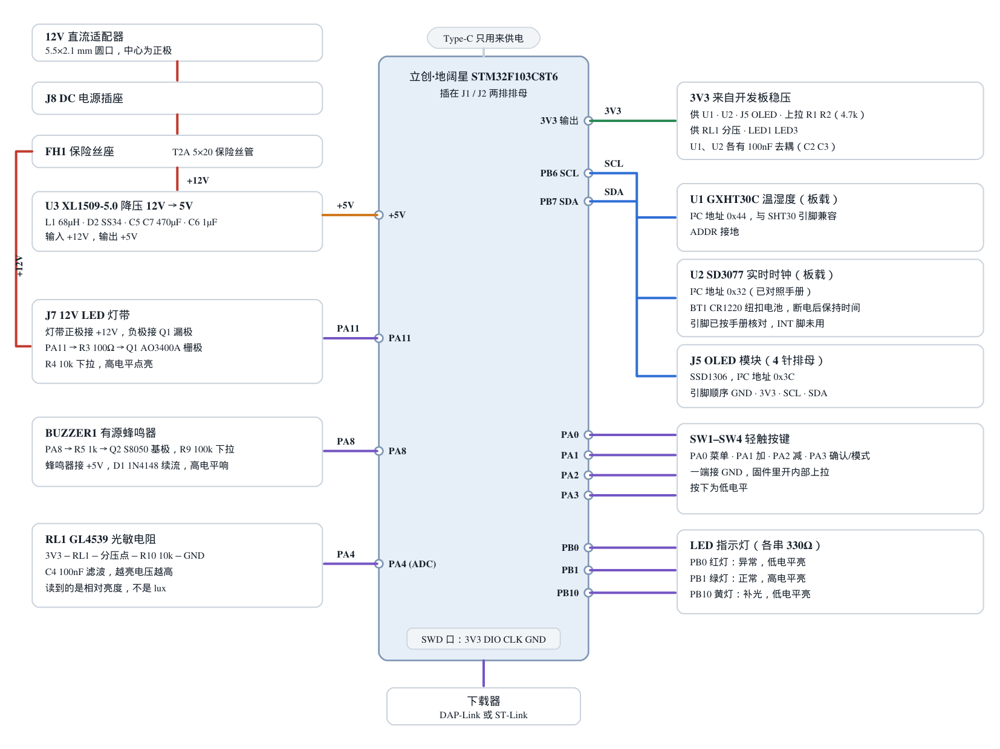

# Graduation-project

毕业设计项目的硬件资料。

## 项目列表

| 目录 | 说明 | 状态 |
|---|---|---|
| [`hardware/stm32-environment-monitor`](hardware/stm32-environment-monitor) | **基于 STM32 的多功能环境智能监控系统**：温湿度、光照、RTC、OLED、按键、LED、蜂鸣器、12V 灯带控制，12V 输入板载降压 | V1.2，已提交嘉立创打样 |
| [`hardware/parking-bluepill`](hardware/parking-bluepill) | **4 车位检测板**：Blue Pill 核心板 + 4 个红外反射传感器 + OLED（KiCad 工程） | `main` 为初版；**更新版在分支 [`claude/blissful-cannon-at318t`](../../tree/claude/blissful-cannon-at318t)**（尚未合并） |

## 环境监控板（V1.2）简介

- 主控：立创·地阔星 STM32F103C8T6 开发板，插在 2×20 排母上。
- 传感与显示：GXHT30C 温湿度、SD3077 实时时钟（CR1220 备份电池）、0.96" OLED（4P 母座）、光敏电阻。
- 输出：有源蜂鸣器、红/绿/黄 LED、12V LED 灯带（AO3400A 开关）。
- 输入：4 个按键（PA0~PA3）。
- 供电：12V DC 座 → 保险丝 → XL1509 降压到 5V；3.3V 由开发板 LDO 提供。
- 下载程序：开发板自带 SWD 口，接 DAP-Link；Type-C 只供电。

更多内容（引脚表、BOM、Gerber、装配注意事项）见
[环境监控板 README](hardware/stm32-environment-monitor/README.md)，
原理图见 [`docs/原理图.png`](hardware/stm32-environment-monitor/docs/原理图.png)。

## 车位检测板的更新版

更新版（2026-11-12）在分支 `claude/blissful-cannon-at318t`，`main` 上还是旧版。主要改动：

- 核心板改为 GD32F103C8T6 Type-C 核心板（引脚与 Blue Pill 兼容）。
- 传感器由 VCNT2030 改为 XL-ITR8307（成兴光，现货，引脚外露好焊）。
- 修正 OLED 引脚顺序，加去耦电容和 GND 铺铜，附嘉立创 SMT 的 BOM。
- PCB 文件改为 KiCad 9 格式，方便导入嘉立创 EDA。

详细说明见该分支的 `hardware/parking-bluepill/CHANGES.md`。

## 工具

- 环境监控板：嘉立创 EDA 专业版（`.epro`）
- 车位检测板：KiCad
